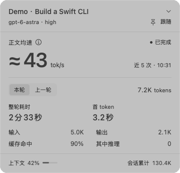
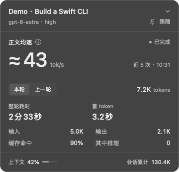

<div align="center">

# CodexSpeed

**看清 Codex 的正文输出速度，在菜单栏留住结果。**

为 Codex 桌面端打造的 macOS 原生伴随工具：持续保留正文均速，查看每轮用量，收进一块紧凑的玻璃面板。

[English](README.md) · **简体中文**


[](LICENSE)

[开始使用](#开始使用) · [速度怎么算](#速度怎么算) · [参与贡献](CONTRIBUTING.zh-CN.md) · [反馈问题](https://github.com/Lmq1111/CodexSpeed/issues/new/choose)




*原生界面渲染，使用构造的示例数据。应用界面目前为简体中文。*

</div>

## 为什么做 CodexSpeed？

一段输出可能在你看向菜单栏前就结束了。CodexSpeed 会在输出停止后保留近期均速，方便你随时查看。

- **跟随当前对话。** 识别最近获得焦点的 Codex 窗口中的会话，也可以固定一个长任务。
- **保留速度结果。** 菜单栏显示 `≈ N tok/s`，使用当前会话、模型和推理档位下最近五个有效正文请求。
- **查看每轮消耗。** 切换本轮与上一轮，查看整轮耗时、已上报的首 token 延迟、工具累计耗时和官方 token 用量。
- **原生 macOS 体验。** AppKit / SwiftUI、系统磨砂材质、浅深色外观，不占 Dock。
- **本机处理。** CodexSpeed 无需 API Key、额外模型请求、分析服务或云端账号，读取已有的本地 Codex 数据。

> **早期、非官方项目。** CodexSpeed 依赖 Codex 桌面端内部 IPC 和本地日志格式，Codex 更新可能影响兼容性。本项目与 OpenAI 没有关联，也未获得其背书。

## 开始使用

### 环境要求

| 项目 | 要求 |
| --- | --- |
| Mac | Apple Silicon，macOS 26 或更新版本 |
| Codex | 支持本地对话的桌面端；初始兼容基准为 `26.1007.71326`、stream-state 协议 v11 |
| 构建工具 | Xcode 26+、Swift 6.2+、macOS 26 SDK |
| 应用签名 | 安装脚本需要本机已有 Apple Development 签名身份 |
| 自动跟随 | 为 CodexSpeed 开启 macOS 辅助功能权限；手动选择无需此权限 |

目前不支持或未验证 Intel Mac、远程主机、ChatGPT Work 云会话及自定义 `CODEX_HOME` 路径。README 提供英文版本，应用本身尚未提供英文界面。

### 构建并安装

当前支持从源码安装，尚未提供公证后的下载包、Homebrew 安装或自动更新。

```sh
git clone https://github.com/Lmq1111/CodexSpeed.git
cd CodexSpeed
swift test
# 安装前先退出正在运行的 CodexSpeed。
./scripts/build-install.sh
open "$HOME/Applications/CodexSpeed.app"
```

安装脚本会构建 Release 可执行文件，打包离线词表和许可证，用本机 Apple Development 身份签名，并安装到 `~/Applications`。它不会修改 Codex 或其数据库。可手动指定签名身份：

```sh
CODEX_SPEED_SIGN_IDENTITY="Apple Development: Your Name (TEAMID)" ./scripts/build-install.sh
```

后续更新请保持相同签名身份，以便 macOS 保留辅助功能授权。没有证书仍可运行 `swift build` 和 `swift test`；安装脚本需要签名身份。环境与权限问题见[故障排查](docs/troubleshooting.zh-CN.md)。

### 首次使用

1. 打开 CodexSpeed，点击菜单栏波形图标。
2. 按提示开启辅助功能权限，启用自动跟随。
3. 在 Codex 查看一个本地对话；能够唯一识别时，面板会自动跟随。
4. 点击“跟随”旁的图钉固定任务；点击“已固定”恢复跟随。
5. 点击顶部对话标题搜索任务；手动选择后会固定该任务。

点击面板外部收起。**Esc** 优先关闭统计说明或对话选择，再关闭主面板。右键菜单栏图标可退出。切换到其他应用后，保留最后确认的对话。

## 速度怎么算？

菜单栏与面板显示同一个**正文接收均速估算**：

```text
正文 tok/s = Σ（官方输出 token − 推理 token）÷ Σ（可见助手正文区间秒数）
```

只纳入**没有生成工具调用、正文计时完整且有效**的请求，避免把工具参数 token 当成正文。每个请求内部重叠的正文区间先取并集；再按当前会话、模型、推理档位取**最近五个有效请求**，使用总 token 除以总时长，而不是直接平均每次的速度。

一次请求是一条模型响应，一轮对话可能包含多次请求，因此样本可能跨轮次。不足五个时使用已有样本；没有新样本时继续保留结果。

`≈` 有实际含义：这些是客户端观察到的消息区间，会受到网络传输和批量到达影响。**它不是服务端纯解码速度、思考速度，也不是模型综合性能基准。** 正文均速排除推理和工具参数，但官方用量仍保留其中实际计入的部分。

| 指标 | 含义 |
| --- | --- |
| 正文均速 | 最近五个有效请求的加权平均，完成后保留 |
| 整轮耗时 | 进行中按可用的轮次起点计时；完成后使用官方 `duration_ms`，包含最终回答输出 |
| 首 token | 官方整轮 `time_to_first_token_ms`，有记录才显示，不是每次请求的平均延迟 |
| 工具累计 | 已记录工具时长之和；并行或嵌套时可能重叠 |
| 输入／输出 | 所选本轮或上一轮的官方用量，包含该轮多次请求 |
| 缓存命中 | 同一轮缓存输入 ÷ 输入 |
| 其中推理 | 输出 token 的子集，不额外加到总量里 |
| 会话累计 | 官方 thread 级 token 累计，不是费用 |
| 上下文 | 最新请求 token 总量 ÷ 已报告上下文窗口的估算，不是历史累计 |

轮次切换器上方的速度始终属于滚动样本窗口；切换“本轮／上一轮”只改变耗时和用量区，不改变均速窗口。详细的筛选规则、未知值和计时限制见[统计口径](docs/metrics.zh-CN.md)。

## 隐私与兼容性

CodexSpeed 读取本地 IPC Socket、`~/.codex` 中的对话目录、所选会话 JSONL 日志，以及用于识别当前会话的辅助功能信息。它不会修改 Codex 安装包、发送提示词或新建模型会话。

正文在内存中处理。本地缓存包含数值摘要、标识符、日志读取位置和路径；可选诊断文件也含有标识符与状态，**不是匿名数据**，分享前应检查。CodexSpeed 不主动持久化聊天正文副本。详见[安全与数据处理](SECURITY.md)。

断线或协议不兼容时，会按退避间隔重连并保留已有结果。实时状态可能不可用，保留的数值不代表模型仍在生成。包括 v0.4.1 对话目录旧错误提示可能残留在内的已知问题，见[故障排查](docs/troubleshooting.zh-CN.md)。

## 开发

```sh
swift build
swift test
```

测试覆盖流式分帧与 revision、重连、用量去重、样本筛选、计时、目录读取和分词。真实 Codex 集成和界面权限仍需人工验证；单元测试通过不代表兼容所有 Codex 版本。

代码结构、验证流程和问题报告要求见[贡献指南](CONTRIBUTING.zh-CN.md)，版本变化见[更新记录](CHANGELOG.md)。

## 致谢

- [swift-tiktoken](https://github.com/DePasqualeOrg/swift-tiktoken)：固定上游提交并随源码提供的 Swift tokenizer。
- [OpenAI tiktoken](https://github.com/openai/tiktoken)：分词定义与打包的 `o200k_base` 词表。

Tokenizer 用于内部可见文本流计数；菜单栏正文均速使用官方用量记录。依赖许可证与词表来源见[第三方声明](THIRD_PARTY_NOTICES.md)。

## 许可证

[MIT](LICENSE) © 2026 Leo Li。随附依赖保留各自许可证声明。
